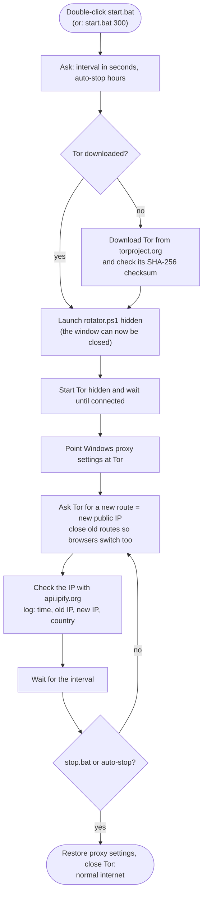

# IP Rotator for Windows

**Change your public IP address automatically, every few minutes or hours. Clone, double-click `start.bat`, done. No account, no login, no install.**

[](#requirements)
[](#requirements)
[](LICENSE)

IP Rotator uses the free, open-source [Tor](https://www.torproject.org/) network. The first
time you run it, it downloads Tor by itself (about 20 MB, official source, checksum-verified),
points Windows' proxy settings at it, and asks Tor for a new IP at the interval you choose.
`stop.bat` puts everything back.

<!-- SCREENSHOT: docs/images/start.png (see docs/images/README.md)

-->

---

## Contents

- [Quick start](#quick-start)
- [What it does](#what-it-does)
- [How it works](#how-it-works)
- [Requirements](#requirements)
- [Usage](#usage)
- [Choosing an interval](#choosing-an-interval)
- [Which apps get the new IP?](#which-apps-get-the-new-ip)
- [Speed expectations](#speed-expectations)
- [FAQ and troubleshooting](#faq-and-troubleshooting)
- [Uninstall](#uninstall)
- [Privacy and security](#privacy-and-security)
- [Project files](#project-files)
- [Disclaimer](#disclaimer)
- [Contributing](#contributing)
- [License](#license)

---

## Quick start

```bat
git clone https://github.com/sakshamwadhankar/IPRotator.git
cd IPRotator
start.bat 300
```

That's it: your IP now changes every 300 seconds (5 minutes). Run `stop.bat` to stop.

**Without a terminal:** click the green **Code** button → **Download ZIP**, extract it, and
double-click **`start.bat`**. It asks how often to change your IP; type a number and press Enter.

## What it does

- **No account, no login, no setup.** Tor is downloaded automatically on the first run, into
  the project folder. Nothing is installed in Windows and no admin rights are needed.
- **You choose the interval** every time you start it (minimum 60 seconds). Your last answer is
  offered as the default. Nothing is hardcoded.
- **Optional auto-stop** after a number of hours.
- **Runs hidden in the background.** Close the window or press Ctrl+C and it keeps going.
- **Checks every change** with [api.ipify.org](https://www.ipify.org/) and logs it to
  `rotator.log` (time, old IP, new IP, country).
- **Puts everything back** when you stop it, and has a safety net that restores your normal
  internet even if the PC restarts while it's running.
- **Never starts with Windows.**

## How it works



Tor sends your traffic through three volunteer-run relays. Websites see the IP of the last one
(the *exit*). Every interval, IP Rotator asks Tor for a fresh route, which means a different
exit and a different IP, and closes the old routes so open browser tabs switch over too.

## Requirements

| What | Notes |
|---|---|
| Windows 10 (version 1803 or newer) or Windows 11 | Windows PowerShell 5.1 and `tar` are built in. |
| An internet connection where Tor isn't blocked | Most home and mobile networks are fine. |

That's all. No VPN app, no OpenVPN, no account, no admin rights.

## Usage

### Start

Double-click **`start.bat`** and answer two questions:

```text
  IP Rotator - start
  ------------------

Change IP every how many seconds? [press Enter for 300]: 300
300 seconds = 5 m 0 s. Start? (Y/N): y
Auto-stop after how many hours? (press Enter = run until I stop it):

  Connecting to Tor.............

  Your IP is now 198.51.100.23 (Netherlands). Your normal IP is 203.0.113.10.
  Running in background, changing IP every 300 seconds. Use stop.bat to stop.
  You can close this window.

Press any key to continue . . .
```

The very first run also shows `First run: downloading Tor (about 20 MB)...` before connecting.

**From a terminal**, skip the questions:

```bat
start.bat 300
```

```bat
start.bat 300 2
```

The first changes the IP every 300 seconds until `stop.bat`; the second also stops by itself
after 2 hours.

- **Interval:** whole seconds only, minimum 60. Invalid input is asked again.
- **Auto-stop:** hours (decimals like `1.5` are fine). Press Enter to run until you stop it.
- The first new IP is set **right away**; after that it changes every interval.
- If it's already running, `start.bat` tells you to run `stop.bat` first.

### Status

Double-click **`status.bat`**:

```text
  IP Rotator - status
  -------------------

  Running            : YES (process 10452)
  Interval           : 300 seconds (5 m 0 s)
  Started            : 2026-10-22 14:00:03
  Auto-stop          : off (runs until you use stop.bat)
  Tor exit country   : Germany
  Next change        : in 3 m 12 s (at 14:10:05)
  Current public IP  : 198.51.100.23  (via Tor)

  Last 10 log lines (rotator.log):
    2026-10-22 14:00:03 | INFO   | Started. Interval 300 s (5 m 0 s), auto-stop off, normal IP 203.0.113.10.
    2026-10-22 14:00:09 | ROTATE | old IP 203.0.113.10 -> new IP 192.0.2.44 | Netherlands
    2026-10-22 14:05:05 | ROTATE | old IP 192.0.2.44 -> new IP 198.51.100.23 | Germany
```

<!-- SCREENSHOT: docs/images/status.png

-->

### Stop

Double-click **`stop.bat`**:

```text
  IP Rotator - stop
  -----------------

  [OK] Rotator stopped.
  [OK] Your normal proxy settings are back.
  Checking your internet connection...
  [OK] Internet works. Your IP is back to your normal one: 203.0.113.10
```

<!-- SCREENSHOT: docs/images/stop.png

-->

*(The IP addresses in these examples are reserved documentation addresses, not real ones.)*

### Desktop shortcuts (optional)

```bat
powershell -NoProfile -ExecutionPolicy Bypass -File make-shortcut.ps1
```

This adds **IP Rotator - Start**, **Stop** and **Status** to your Desktop.

<!-- SCREENSHOT: docs/images/shortcuts.png

-->

## Choosing an interval

| Interval | Good for |
|---|---|
| 60-300 s (1-5 min) | Testing. Expect short interruptions often. |
| 600-3600 s (10-60 min) | Everyday use. |
| 3600 s and more | Long sessions: fewer interruptions. |

**Why at least 60 seconds?** Every change builds new routes through the Tor network, which is
run by volunteers. Changing more often than once a minute adds load for everyone without
helping you. Tor itself also allows a new route at most every 10 seconds. The minimum is set in
`config.ps1` (`$MIN_INTERVAL_SECONDS`).

## Which apps get the new IP?

IP Rotator works through **Windows' proxy settings** (the same ones in *Settings → Network &
internet → Proxy*).

- **Yes:** Chrome, Edge, Firefox (with its default "use system proxy settings"), and other apps
  that follow Windows' proxy settings.
- **No:** games, apps that ignore proxy settings, `ping`, and anything that isn't web traffic.
  Changing the IP for literally every app needs a VPN driver, which requires an install and
  admin rights; IP Rotator deliberately avoids that.

Tor may use a few routes at the same time, so two different websites can see two different Tor
IPs. Neither of them is your real IP, and both change at every interval.

## Speed expectations

- **Tor is slower than your normal connection.** Pages load fine; big downloads and video are slower.
- **Speed depends on the exit.** Some changes land on a fast exit, some on a slower one.
- **There's a short interruption at each change** (a second or two), because old connections are
  closed so your browser switches to the new IP. Downloads or calls running at that moment are cut.
- **Some websites block Tor or show CAPTCHAs.** Stop the rotator while you use those.

## FAQ and troubleshooting

<details>
<summary><b>The Tor download fails</b></summary>

Your network may block `torproject.org`. Try another network (for example a phone hotspot) once;
after the first download Tor stays in the `tor` folder. You can also download the
**Tor Expert Bundle for Windows (x86_64)** yourself from
<https://www.torproject.org/download/tor/> and extract it into a folder named `tor` inside
this project.
</details>

<details>
<summary><b>"Tor couldn't connect within 120 seconds"</b></summary>

Your network or country probably blocks Tor. IP Rotator doesn't support Tor bridges, so try a
different network.
</details>

<details>
<summary><b>The IP in my browser didn't change</b></summary>

- Reload the page. Pages that were already loaded keep showing what they loaded.
- Run `status.bat` to see when the last change happened, and check `rotator.log` for `WARN` or
  `ERROR` lines.
- Make sure your browser uses the system proxy. In Firefox: *Settings → Network Settings →
  Use system proxy settings*.
- Different websites may see different Tor IPs (see [above](#which-apps-get-the-new-ip)).
</details>

<details>
<summary><b>Internet not working after stop, or after a restart</b></summary>

1. Run **`stop.bat`**. It always closes Tor and restores your proxy settings.
2. If the PC restarted while IP Rotator was running, a one-time safety net restores your proxy
   settings at your next sign-in; run `stop.bat` if a page still doesn't load.
3. Still nothing? Open *Settings → Network & internet → Proxy* and turn off
   **Use a proxy server**.
</details>

<details>
<summary><b>Windows blocks the scripts ("Windows protected your PC")</b></summary>

Files from a downloaded ZIP are marked as coming from the internet. Click **More info → Run
anyway**, or before extracting right-click the ZIP → **Properties** → tick **Unblock**. Cloning
with `git` doesn't have this problem. Always run the `.bat` files rather than the `.ps1` files:
they start PowerShell with `-ExecutionPolicy Bypass` for that one process only. Your system's
execution policy is never changed.
</details>

<details>
<summary><b>My antivirus warns about tor.exe</b></summary>

Some antivirus products flag Tor because it can be misused. IP Rotator downloads it only from
the Tor Project's own servers and checks the SHA-256 checksum they publish, then deletes the
download if it doesn't match.
</details>

<details>
<summary><b>Can I use it together with Tor Browser?</b></summary>

Yes. IP Rotator uses its own ports (19050, 19051, 19080), so it doesn't clash with Tor Browser.
</details>

<details>
<summary><b>Does it start automatically with Windows?</b></summary>

No. The only thing that ever runs at sign-in is the one-time safety net, and only if the PC
restarted while IP Rotator was running. It restores your normal proxy settings and doesn't start
the rotator. It removes itself after running once, or when you stop IP Rotator normally.
</details>

<details>
<summary><b>Does this make me anonymous?</b></summary>

No. It changes the IP that websites see. Logins, cookies and browser fingerprints can still
identify you. For real anonymity use [Tor Browser](https://www.torproject.org/download/).
</details>

## Uninstall

1. Run **`stop.bat`**.
2. If you made Desktop shortcuts, delete them or run
   `powershell -NoProfile -ExecutionPolicy Bypass -File make-shortcut.ps1 -Remove`.
3. Delete the project folder. It contains Tor, its cache and the log, so nothing is left behind.

Nothing was installed in Windows.

## Privacy and security

**No accounts or passwords.** IP Rotator doesn't use or store any credentials.

**What changes on your PC while it runs**
- Your Windows proxy settings (for your user account only) point at Tor on `127.0.0.1`. The
  originals are saved in `proxy-backup.json` and restored when it stops.
- A one-time "RunOnce" entry restores those settings if the PC restarts mid-run. It's removed
  when you stop normally.

**What is logged (locally only)**
- `rotator.log`: time of each change, old and new IP, country, warnings and errors. It rolls over
  at 1 MB (one old copy, `rotator.log.1`, is kept).
- `state.json`: what `status.bat` shows, including your normal IP.
- `settings.json`: your last interval.
- `tor-data/`: Tor's own cache and log.

None of these are uploaded anywhere, and all are excluded by `.gitignore`.

**What it connects to**
- `aus1.torproject.org` and `dist.torproject.org` (or `archive.torproject.org`), only to
  download Tor the first time.
- The Tor network, for your traffic.
- `https://api.ipify.org`, to read your public IP.

No telemetry, no analytics, no auto-updates.

**Use HTTPS.** Tor exit relays can see traffic to plain `http://` websites. HTTPS sites (the
padlock in your browser) stay encrypted end to end.

## Project files

```text
IPRotator/
├─ start.bat  / start.ps1     asks the questions (or takes them as arguments), starts the rotator hidden
├─ stop.bat   / stop.ps1      stops it, closes Tor, restores your proxy settings, checks your internet
├─ status.bat / status.ps1    shows what it's doing
├─ rotator.ps1                the background loop
├─ common.ps1                 shared helper functions
├─ config.ps1                 settings (minimum interval, ports, paths)
├─ make-shortcut.ps1          optional Desktop shortcuts (-Remove to delete them)
├─ tor/                       Tor, downloaded on first run (not in git)
└─ docs/images/               screenshots for this README
```

## Disclaimer

IP Rotator is meant for **privacy and other legitimate uses only**. You are responsible for how
you use it. Follow the Terms of Service of the websites and services you use and the laws of
your country. Don't use it to evade bans, abuse services or break the law.

This project is **not affiliated with, endorsed by or sponsored by The Tor Project, Inc.** or
ipify. "Tor" is a trademark of The Tor Project, Inc. The software is provided "as is", without
warranty of any kind (see [LICENSE](LICENSE)).

## Contributing

Bug reports, ideas and pull requests are welcome. See [CONTRIBUTING.md](CONTRIBUTING.md), and use
the issue templates for [bugs](../../issues/new?template=bug_report.md) and
[feature requests](../../issues/new?template=feature_request.md). Please remove your real IP
address from anything you paste.

## License

[MIT](LICENSE) © 2026 Saksham Wadhankar
