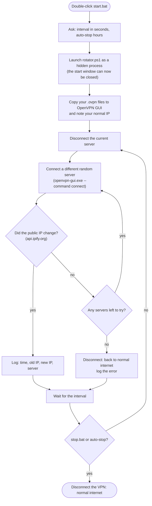

# IP Rotator for Windows

**Change your public IP address automatically, on a schedule you choose, using free tools: OpenVPN GUI and Proton VPN's free servers.**

[](#requirements)
[](#requirements)
[](LICENSE)

Double-click **Start**, type how often you want a new IP (for example every 10 minutes), and
IP Rotator switches you to a different Proton VPN free server at that interval in the
background until you click **Stop**.

<!-- SCREENSHOT: docs/images/start.png (see docs/images/README.md)

-->

---

## Contents

- [What it does](#what-it-does)
- [How it works](#how-it-works)
- [Requirements](#requirements)
- [Quick start](#quick-start)
- [Detailed setup](#detailed-setup)
- [Usage](#usage)
- [Choosing an interval](#choosing-an-interval)
- [Speed expectations](#speed-expectations)
- [FAQ and troubleshooting](#faq-and-troubleshooting)
- [Uninstall](#uninstall)
- [Privacy and security](#privacy-and-security)
- [Project files](#project-files)
- [Disclaimer](#disclaimer)
- [Contributing](#contributing)
- [License](#license)

---

## What it does

- **Asks you every time** how often to change your IP. Nothing is hardcoded: you type the
  interval in seconds (minimum 60), and your last answer is offered as the default.
- **Optional auto-stop** after a number of hours, or it runs until you stop it.
- **Runs hidden in the background.** Once it's started you can close the window, or press
  Ctrl+C, and it keeps going.
- **Checks that the IP really changed** (via [api.ipify.org](https://www.ipify.org/)). If a
  server fails or gives the same IP, it tries another one.
- **Falls back safely.** If every server fails, it disconnects so your normal internet
  keeps working, and tries again at the next interval.
- **Logs every switch** (time, old IP, new IP, server) to `rotator.log`.
- **No admin prompts** while running, **never starts with Windows**, and **no passwords in
  the scripts**.

## How it works



Proton's free plan allows **one connection at a time**, so each switch is
*disconnect, then connect*. Your internet drops for a few seconds during each switch.

IP Rotator controls OpenVPN GUI through its official command-line interface
(`openvpn-gui.exe --command connect | disconnect | rescan`). OpenVPN GUI's own
*Interactive Service* does the parts that need admin rights, so no UAC prompt appears.

## Requirements

| What | Notes |
|---|---|
| Windows 10 or 11 | Windows PowerShell 5.1 is built in. Nothing else to install for the scripts. |
| [OpenVPN Community](https://openvpn.net/community-downloads/) (includes OpenVPN GUI) | Free. Installing it is the **only** step that needs admin rights. |
| A free [Proton VPN](https://protonvpn.com/free-vpn) account | Free plan: free servers only, one connection at a time. |
| At least 2 Proton **free-server UDP** `.ovpn` files | More files mean more different IPs to rotate through. |

## Quick start

1. **Install OpenVPN** from <https://openvpn.net/community-downloads/> (Windows 64-bit MSI, default options).
2. **Download this project** (green **Code** button → **Download ZIP**). Right-click the ZIP →
   **Properties** → tick **Unblock** → **OK**, then extract it anywhere, e.g. `Documents\IPRotator`.
3. **Add configs:** put at least 2 Proton free-server **UDP** `.ovpn` files in the `configs` folder
   ([how to get them](#3-download-free-server-udp-configs)).
4. **Double-click `setup.bat`** and enter your Proton **OpenVPN** username and password when asked
   ([where to find them](#2-find-your-openvpn-username-and-password)).
5. **Double-click "IP Rotator - Start"** on your Desktop and type an interval, e.g. `600` (10 minutes).

That's it. Use **"IP Rotator - Status"** to see what it's doing and **"IP Rotator - Stop"** to stop.

## Detailed setup

### 1. Create a free Proton VPN account

Sign up for the free plan at <https://protonvpn.com/free-vpn>. You don't need to install
the Proton VPN app; IP Rotator uses OpenVPN GUI instead. If you do have the Proton VPN app,
make sure it's **disconnected** while IP Rotator runs, because the free plan allows only one
connection.

### 2. Find your OpenVPN username and password

> [!IMPORTANT]
> These are **not** your Proton email and password. Proton generates a separate
> **OpenVPN / IKEv2 username and password** for apps like OpenVPN GUI.

Sign in at <https://account.protonvpn.com> and open the **OpenVPN / IKEv2 username**
section. Proton's step-by-step guide:
[How to find your OpenVPN / IKEv2 credentials](https://protonvpn.com/support/vpn-login/).

You'll type these into `setup.bat` in step 5.

### 3. Download free-server UDP configs

In your Proton VPN account, open **Downloads → OpenVPN configuration files** and choose
**Platform: Windows**, **Protocol: UDP** and the **free server** configs. Download several
(from different countries if you like) and put the `.ovpn` files in this project's
`configs` folder. Proton's guide:
[How to download OpenVPN configuration files](https://protonvpn.com/support/vpn-config-download).

You don't need to import them into OpenVPN GUI yourself; IP Rotator does that. (For
background, Proton's
[OpenVPN GUI guide for Windows](https://protonvpn.com/support/openvpn-windows-setup/)
explains the manual way.)

### 4. Install OpenVPN GUI

Download the **Windows 64-bit MSI installer** from the official page,
<https://openvpn.net/community-downloads/>, and install it with the default options.
This is the only step that needs admin rights. The default install includes the
*OpenVPN Interactive Service*, which lets IP Rotator connect without admin prompts later.

### 5. Run setup.bat

Double-click `setup.bat`. It will:

1. check your Windows version,
2. check that OpenVPN GUI is installed (if not, it shows the download link and stops),
3. create the `configs` folder and count your `.ovpn` files,
4. unblock the scripts so Windows stops warning about them,
5. ask for your OpenVPN username and password (the password is hidden while you type) and
   save them to a file that only your Windows account can read
   ([details](#privacy-and-security)),
6. create three Desktop shortcuts: **IP Rotator - Start**, **Stop** and **Status**.

You can run `setup.bat` again at any time, for example to change your saved credentials.

<!-- SCREENSHOT: docs/images/setup.png

-->

<!-- SCREENSHOT: docs/images/shortcuts.png

-->

## Usage

### Start

Double-click **IP Rotator - Start** (or `start.bat`) and answer two questions:

```text
  IP Rotator - start
  ------------------

Change IP every how many seconds? [press Enter for 600]: 7200
7200 seconds = 2 h 0 m. Start? (Y/N): y
Auto-stop after how many hours? (press Enter = run until I stop it): 8

  Running in background, changing IP every 7200 seconds. Use stop.bat to stop.
  It will stop by itself after 8 h (at 22:15, Thu 22 Oct).
  The first switch is happening now and takes about 10-30 seconds.
  status.bat shows what it is doing. You can close this window.

Press any key to continue . . .
```

- **Interval:** whole seconds only, minimum 60. If you type something invalid, it asks again.
  Press Enter to reuse your last interval.
- **Auto-stop:** hours (decimals like `1.5` are fine). Press Enter to run until you stop it.
- The first IP change happens **right away**, then every interval after that.
- If it's already running, `start.bat` refuses to start a second copy and tells you to run
  `stop.bat` first.

### Status

Double-click **IP Rotator - Status** (or `status.bat`):

```text
  IP Rotator - status
  -------------------

  Running            : YES (process 10452)
  Interval           : 600 seconds (10 m 0 s)
  Started            : 2026-10-22 14:00:03
  Auto-stop          : off (runs until you use stop.bat)
  Server in use      : jp-free-3.protonvpn.udp
  Next switch        : in 7 m 12 s (at 14:20:05)
  Current public IP  : 198.51.100.23  (via VPN)

  Last 10 log lines (rotator.log):
    2026-10-22 14:00:03 | INFO   | Started. Interval 600 s (10 m 0 s), auto-stop off, 6 UDP configs, normal IP 203.0.113.10.
    2026-10-22 14:00:21 | ROTATE | old IP 203.0.113.10 -> new IP 192.0.2.44 | server nl-free-7.protonvpn.udp
    2026-10-22 14:10:19 | ROTATE | old IP 192.0.2.44 -> new IP 198.51.100.23 | server jp-free-3.protonvpn.udp
```

<!-- SCREENSHOT: docs/images/status.png

-->

*(The IP addresses in these examples are reserved documentation addresses, not real ones.)*

### Stop

Double-click **IP Rotator - Stop** (or `stop.bat`). It stops the background rotator,
disconnects the VPN and checks that your normal internet works:

```text
  IP Rotator - stop
  -----------------

  [OK] Rotator stopped.
  Disconnecting the VPN...
  [OK] VPN disconnected.
  Checking your internet connection...
  [OK] Internet works. Your IP is back to your normal one: 203.0.113.10
```

<!-- SCREENSHOT: docs/images/stop.png

-->

## Choosing an interval

| Interval | Good for |
|---|---|
| 60-300 s (1-5 min) | Testing. Expect frequent short drops. |
| 600-3600 s (10-60 min) | Everyday use. |
| 3600 s and more | Long sessions: fewer interruptions. |

**Why at least 60 seconds?** Each switch takes about 10-30 seconds (disconnect, connect,
check the IP). Proton's free servers are shared by many people, and reconnecting very often
can get a free account throttled or temporarily refused. The minimum is set in
`config.ps1` (`$MIN_INTERVAL_SECONDS`).

The interval is counted from the **start** of one switch to the start of the next. If a
switch takes unusually long (several servers failed), the timer restarts when it finishes.

## Speed expectations

- **Free servers are medium speed.** They're shared and Proton gives paid users priority, so
  expect slower downloads than your normal connection, especially at busy times.
- **Distance matters.** A server in a far-away country adds noticeable delay (higher ping).
  Configs from countries near you feel faster.
- **There's a short drop during each switch** (usually 5-30 seconds). Downloads,
  video calls and games will be interrupted when the IP changes, so choose a longer interval
  if that matters to you.
- The free plan has a limited set of countries, so you'll see the same IPs come back over time.

## FAQ and troubleshooting

<details>
<summary><b>"OpenVPN GUI is not installed" / OpenVPN GUI not found</b></summary>

Install OpenVPN Community from <https://openvpn.net/community-downloads/> and run
`setup.bat` again. If you installed it in an unusual folder, open `config.ps1` and set
`$OPENVPN_GUI_PATH` to the full path of `openvpn-gui.exe`.
</details>

<details>
<summary><b>Auth failed (<code>AUTH_FAILED</code> in rotator.log)</b></summary>

- Make sure you entered the **OpenVPN / IKEv2** username and password, **not** your Proton
  email login ([where to find them](#2-find-your-openvpn-username-and-password)). Run
  `setup.bat` again to re-enter them.
- The free plan allows **one connection at a time**. Disconnect the Proton VPN app and any
  other device using your account.
- If you recently reset your OpenVPN password in your Proton account, re-enter it with
  `setup.bat`.
</details>

<details>
<summary><b>The IP isn't changing</b></summary>

- Run `status.bat` and look at the log lines. `WARN` and `ERROR` lines explain what went wrong.
- You need **at least 2** UDP configs in `configs\`, ideally from different servers or
  countries.
- Make sure no other VPN (like the Proton VPN app) is connected at the same time.
- If you added configs while the rotator was running, run `stop.bat` and then `start.bat`.
- If OpenVPN GUI was already open before you added configs and doesn't seem to see them,
  right-click its tray icon → **Exit**, then start again.
- Check you can connect manually: right-click the OpenVPN GUI tray icon, pick one of the
  `iprot-...` connections and choose **Connect**.
</details>

<details>
<summary><b>Internet not working after stop</b></summary>

1. Run `stop.bat` again. It disconnects any connection left over from IP Rotator.
2. Right-click the OpenVPN GUI icon in the system tray and choose **Disconnect** on any
   connected entry, or **Exit** to close OpenVPN GUI completely.
3. Wait 10 seconds and run `status.bat` to check.
4. Still nothing? Open Command Prompt and run `ipconfig /flushdns`, or restart your PC. The
   VPN's network changes are undone when OpenVPN closes, so a restart always clears them.
</details>

<details>
<summary><b>Windows blocks the scripts ("Windows protected your PC", "running scripts is disabled")</b></summary>

- Files downloaded from the internet are marked as "blocked". Before extracting, right-click
  the ZIP → **Properties** → tick **Unblock**. If you already extracted it, click
  **More info → Run anyway** once on `setup.bat`; setup then unblocks the rest.
- Always start things with the `.bat` files (or the Desktop shortcuts), not by
  double-clicking `.ps1` files. The `.bat` files run PowerShell with
  `-ExecutionPolicy Bypass` for **that one process only**. Your system's execution policy
  is never changed.
</details>

<details>
<summary><b>A connection fails with a message about the "OpenVPN Interactive Service"</b></summary>

The service only lets some accounts start connections without admin rights. Add your account
to the **OpenVPN Administrators** group once. Open Command Prompt **as administrator** and
run the command below, then sign out of Windows and back in:

```bat
net localgroup "OpenVPN Administrators" "%USERNAME%" /add
```
</details>

<details>
<summary><b>Does it start automatically with Windows?</b></summary>

No. IP Rotator only runs when you start it. (The OpenVPN installer may add OpenVPN GUI itself
to startup if you left that option ticked. It only sits in the tray and doesn't connect by
itself.)
</details>

<details>
<summary><b>Is my real IP visible during a switch?</b></summary>

Briefly, yes. Between disconnecting one server and connecting the next, and if every server
fails, your traffic uses your normal connection. IP Rotator has no "kill switch", because
that would need admin-level firewall rules.
</details>

<details>
<summary><b>Can I use other VPN providers or Proton paid plans?</b></summary>

IP Rotator is designed for Proton VPN Free. Any OpenVPN **UDP** config that logs in with a
username and password should work the same way, but only Proton Free is supported.
</details>

## Uninstall

1. Run **`stop.bat`** so nothing is connected.
2. Remove the Desktop shortcuts. Delete them, or from the project folder run:
   ```bat
   powershell -NoProfile -ExecutionPolicy Bypass -File make-shortcut.ps1 -Remove
   ```
3. Delete your saved credentials: the folder **`%USERPROFILE%\.iprotator`**.
4. Delete the config copies: **`%USERPROFILE%\OpenVPN\config\IPRotator`** (and, if you like,
   the `iprot-*.log` files in `%USERPROFILE%\OpenVPN\log`).
5. Delete the project folder.
6. Optional: uninstall **OpenVPN** from *Settings → Apps*.

Nothing else is installed, and no system settings were changed.

## Privacy and security

**Your credentials**
- The scripts never contain your username or password.
- `setup.bat` saves your Proton **OpenVPN** username and password to
  `%USERPROFILE%\.iprotator\proton-auth.txt`, outside the project folder.
- That folder and file are locked with Windows permissions so that **only your Windows
  account** can open them. Inherited permissions are removed. (Administrators of the PC
  can always take over any file, as with everything on Windows.)
- The file is plain text, because OpenVPN needs to read it each time it connects. That's
  what lets the hidden rotator switch servers without login pop-ups. Treat your PC account
  like the key to it, and re-run `setup.bat` if you change your OpenVPN password.
- These credentials are only for VPN connections. They can't be used to sign in to your
  Proton account.

**What is logged (locally only)**
- `rotator.log`: time of each switch, old and new public IP, server name, warnings and errors.
  It rolls over at 1 MB (one old copy, `rotator.log.1`, is kept).
- `state.json`: what `status.bat` shows, including your normal IP.
- `settings.json`: your last interval.
- OpenVPN GUI keeps its own connection logs in `%USERPROFILE%\OpenVPN\log`.

None of these are uploaded anywhere, and all are excluded by `.gitignore`.

**What it connects to**
- Proton VPN's servers (from your `.ovpn` files).
- `https://api.ipify.org`, to read your public IP.

Nothing else. No telemetry, no analytics, no auto-updates.

**Admin rights:** only for installing OpenVPN. The scripts themselves never ask for admin
rights, never change the system execution policy, and never add anything to Windows startup.

## Project files

```text
IPRotator/
├─ setup.bat / setup.ps1        one-time setup
├─ start.bat / start.ps1        asks the questions, launches the rotator hidden
├─ stop.bat  / stop.ps1         stops it, disconnects, checks your internet
├─ status.bat / status.ps1      shows what it's doing
├─ rotator.ps1                  the background loop
├─ common.ps1                   shared helper functions
├─ config.ps1                   settings (minimum interval, paths, timeouts)
├─ make-shortcut.ps1            Desktop shortcuts (-Remove to delete them)
├─ configs/                     your .ovpn files go here (not uploaded)
└─ docs/images/                 screenshots for this README
```

## Disclaimer

IP Rotator is meant for **privacy and other legitimate uses only**. You are responsible for
how you use it. Follow the Terms of Service of the websites and services you use, Proton
VPN's terms of service, and the laws of your country. Changing your IP doesn't make you
anonymous, and it must not be used to evade bans, abuse services or break the law.

This project is **not affiliated with, endorsed by or sponsored by Proton AG or the OpenVPN
project / OpenVPN Inc.** "Proton VPN" and "OpenVPN" are trademarks of their respective
owners. The software is provided "as is", without warranty of any kind (see [LICENSE](LICENSE)).

## Contributing

Bug reports, ideas and pull requests are welcome. See [CONTRIBUTING.md](CONTRIBUTING.md),
and use the issue templates for [bugs](../../issues/new?template=bug_report.md) and
[feature requests](../../issues/new?template=feature_request.md). Please remove your IP
addresses and credentials from anything you paste.

## License

[MIT](LICENSE) © 2026 Saksham Wadhankar
